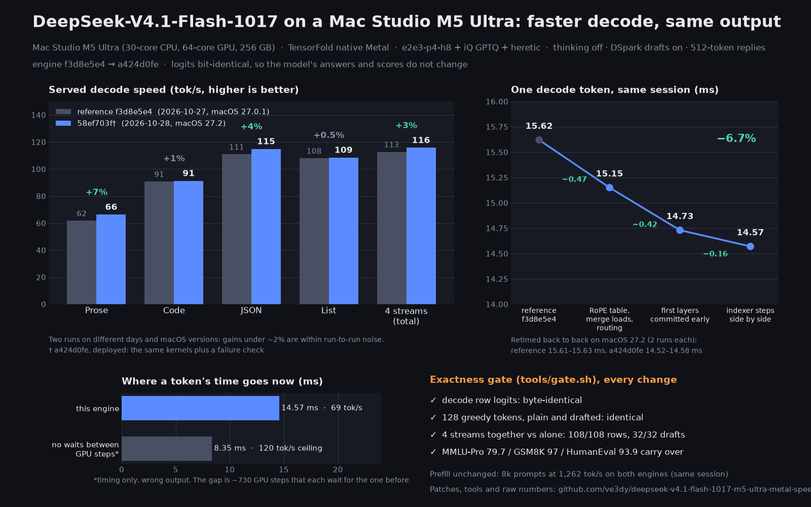

# DeepSeek-V4.1-Flash-1017 on one M5 Ultra: faster decode, same output



Decode speedups for DeepSeek-V4.1-Flash-1017 on TensorFold's native Metal engine whose logits are **bit-identical** to
the engine they start from, so the model's scores cannot change. Measured on a Mac Studio M5 Ultra, 64-core GPU,
256 GB, macOS 27.2 (the reference's served run: 27.0.1), with an `e2e3-p4-h8`-layout checkpoint (GPTQ tensors and a
heretic `wo_b`; any checkpoint of that layout works). Retimed back to back on 27.2, two runs each: a decode row
15.61–15.63 ms on the reference, 14.52–14.58 ms on `a424d0fe`.

| | reference | these patches |
|---|---|---|
| A decode row (ms) | 15.62 | 14.57 |
| Served prose / code / JSON / list (tok/s) | 61.8 / 90.8 / 110.9 / 108.0 | 66.3 / 91.3 / 114.8 / 108.5 |
| Four streams (tok/s) | 112.7 | 115.7 |
| Prefill at 8k (tok/s) | 1,260 | 1,264 |

Served numbers: `bench.py`-style 512-token replies, thinking off, DSpark drafts on. Code and lists draft most of
their tokens, so they move less. Details: `results/speedups-2026-10-28.txt`.

## The patches

On [BobClawblaw/TensorFold](https://github.com/BobClawblaw/TensorFold/tree/deepseek-v41-main) `72a552ed`; all apply
with `git am`.

| | what |
|---|---|
| 0001 | No `required > max` kernel faults on a 256 GB Mac: unretained command buffers, the weights' residency set off the queue (the reference engine) |
| 0002, 0003, 0007 | Measuring tools in `tf-dsv41-forward` (below) |
| 0004 | A RoPE (cos, sin) table a call that the attention, merge, window-key and rope kernels read instead of each computing it; the merge's partials loaded before its softmax totals; routing with one threadgroup barrier instead of three a pick |
| 0005 | The first two layers committed while the host encodes the rest (host time a call 0.72 → 0.29 ms) |
| 0006 | The compressor's and indexer's independent steps side by side (34 barriers fewer) |
| 0008 | The early-committed command buffer kept: its failure reported, its GPU time counted |

## Checking exactness: `tools/gate.sh`

Against the reference engine's own outputs (made once): a decode row's logits byte for byte, 128 greedy tokens plain
and DSpark-drafted, and four streams' shared windows against each alone (logits and drafts). It prints `GATE: pass`
or exits 1 when any check is missing or differs. Every patch above passed it.

## Where the time goes

A decode row is 1,045 dispatches and 730 barriers. With every barrier removed (wrong output, timing only) it takes
8.35 ms, against 14.57 ms. The kernels are near bandwidth when they overlap (the routed-expert kernel reads at
83–88% of the 1,228 GB/s peak, `results/expert-kernel-2026-10-28.txt`); the rest is the chain of dependent steps.
Each costs its own latency, not the barrier's: a tiny dependent dispatch costs ~2 µs (`tools/barrier_bench.swift`),
while the attention's split step takes 17.6 µs, the hyper-connection boundary 8.1 µs and the router 11 µs as
dependent steps (`DS_SWEEP=replay`).

Tried and not kept, with numbers in `results/`: the expand and boundary in one dispatch (exact, but the boundary on
one threadgroup is slower than the extra dispatch); the routed-expert kernel at 13 other shapes; row kernels with
prefetched codes; a serial encoder; polling instead of waiting; DSpark drafts on prose (acceptance below the ~54%
they need). The GPU ran at its maximum performance state during decode (Metal System Trace).

## Next

1. **The attention's split and merge** (1 ms a row together): fewer key chunks change the sums, so an exact version
   needs the same 16-key partials with less traffic between the two.
2. **The compressor and indexer beside the query path** (they read only the normed input and the query latent).
3. **100 tok/s needs ≤ 10 ms a row**, under the no-barrier bound, so most of the 730 dependent steps have to shrink.
   A persistent kernel a layer with a device-wide barrier is one shape, but Metal does not promise that all of a
   grid's threadgroups are resident at once: if some wait on others that never get scheduled (the GPU shared with
   the window server or another model), the command hangs, and a hung GPU command can take the display with it. It
   needs a grid at or below the measured resident capacity and an aborting timeout.

## Run it

```bash
git clone https://github.com/BobClawblaw/TensorFold && git -C TensorFold checkout -b dev 72a552ed
git -C TensorFold am "$PWD"/patches/*.patch
(cd TensorFold && zig build tf-dsv41-forward -Doptimize=ReleaseFast -Dcpu=apple_m1)   # needs the Metal Toolchain
python tools/make_ids.py MODEL_DIR prose256.npy
DS_SWEEP=1 TensorFold/zig-out/bin/tf-dsv41-forward MODEL_DIR prose256.npy out
```

`72a552ed` is on BobClawblaw/TensorFold's `deepseek-v41-main`. The decode row needs ~210 GiB, so stop any model
server first.

`tf-dsv41-forward` modes (environment):

| | |
|---|---|
| `DS_SWEEP=keys` | One load, a decode row timed whole per key: `""` plain, a pipeline name (left out), `rows`, `indexed`, `!`, `nobar`, `serial`, `nb:LABEL`, `ec:N` (layers before the early commit), `gsg:N` (ds_gemv simdgroups), `exp:NAME=VAR` (pipeline NAME runs `DS_EXP`'s kernel VAR), `trace`, `lat`, `replay`, `rx:NAME=VAR1+VAR2` (NAME's dispatches alone with each variant), `kbench`. Each timed line gives ms, GPU and host ms, dispatches, barriers, and whether the logits equal the plain row's; `DS_REF=file` compares the plain row with another build's |
| `DS_EXP=kernels/v41_exp.metal` | Experimental kernels, compiled after the family's (ablations and candidates) |
| `DS_DRAFT=N` | N greedy tokens plain and DSpark-drafted |
| `DS_SHARED=N` | N rounds of four streams' windows against each alone |
| `DS_PREFILL=1` | The prompt in 1,024-row chunks as the server runs it, tok/s |

Other tools: `tools/gate.sh`, `tools/sweep.sh`, `tools/trace.sh` (Metal System Trace), `tools/barrier_bench.swift`,
`tools/cache_bench.swift`, `tools/heater.swift`. The three shell tools read their settings from the environment or
from `tools/local.env` (not in git; see `tools/env.sh`): the checkpoint, the two engine builds, and optional commands
that stop your model server before a run, start it again afterwards, and wait until no client is mid-request.

## License

MIT for this repository. The patches are against TensorFold (Apache-2.0); the model is MIT.
